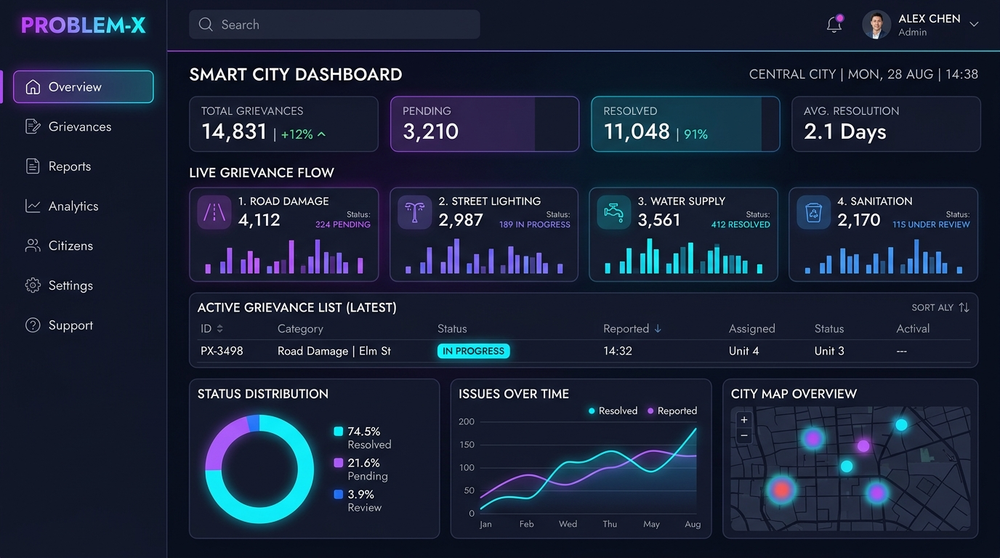

# 🚀 Umair Farooqui - Developer Portfolio

An interactive, high-performance personal portfolio built for **Umair Farooqui** (Web Developer / Full-Stack Developer).



---

## ✨ Features

- 🎨 **Modern Dark & Light Mode**: Seamless theme switcher with persistent preferences in `localStorage`.
- ⌨️ **Interactive Developer Terminal (CLI)**: Built-in terminal allowing visitors to run commands like `help`, `about`, `skills`, `projects`, and `contact`.
- 🔍 **Command Palette (`Ctrl + K`)**: Quick access launcher for fast navigation and actions.
- 🔊 **Web Audio Synthesizer**: Subtle UI audio feedback powered by the Web Audio API (zero audio asset dependencies, muted by default).
- 🐙 **Live GitHub Integration**: Dynamically loads real-time stats and repositories from GitHub (`Farooqui-codes`).
- 📱 **Progressive Web App (PWA)**: Offline caching via Service Worker (`sw.js`) and mobile installable (`manifest.json`).
- ⚡ **Optimized Performance & Responsive**: Smooth mobile drawer navigation, tilt card animations, and responsive layouts across all screen sizes.

---

## 🛠️ Tech Stack

- **Frontend**: HTML5, Vanilla CSS3 (Custom Properties & Animations), Modern Vanilla JavaScript (ES6+)
- **Icons & Typography**: Font Awesome 6, Google Fonts (Poppins & Fira Code)
- **Features**: Web Audio API, GitHub REST API, Web3Forms API, Service Workers (PWA)

---

## 📂 Project Structure

```text
MY PORTFOLIO ADV/
├── index.html          # Main HTML structure & semantic layout
├── style.css           # Styling, animations, theme tokens & responsive design
├── script.js           # CLI terminal, command palette, audio, GitHub API & UI logic
├── sw.js               # Service Worker for PWA caching & offline support
├── manifest.json       # PWA manifest configuration
├── MY_Resume.pdf       # Downloadable resume
└── assets & images     # Project screenshots and icons
```

---

## 🚀 Getting Started

1. **Clone the repository:**
   ```bash
   git clone https://github.com/Farooqui-codes/<your-repo-name>.git
   ```

2. **Open `index.html`** directly in your browser or run a live server:
   ```bash
   npx serve .
   ```

---

## 📬 Contact & Socials

- **GitHub**: [@Farooqui-codes](https://github.com/Farooqui-codes)
- **Portfolio**: Farooqui.dev
